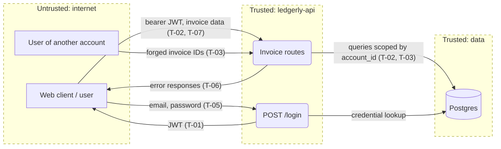

# Threat model: ledgerly-api

**Scope:** whole system
**Last updated:** 2026-08-12
**Owner:** platform team

Invoicing API for small businesses, used by owners and members of each business account
through a separate web client. The threats that matter most are one account reading another
account's invoices and credential stuffing against the login endpoint.

## 1. What are we working on?

### System profile

| Application | Type | Stack | Deployed as | Auth | Tenancy | AI |
| --- | --- | --- | --- | --- | --- | --- |
| ledgerly-api | HTTP API | Node 20, Express 4, pg, Postgres | container | bearer JWT (HS256) issued by POST /login | `account_id` on every table, taken from the JWT | none |

Architecture: single HTTP API; the web client is a separate repository.
Data stores: Postgres (accounts, users, invoices).
External systems: none.
Multi-tenancy: `accountId` claim in the JWT, applied in each query's `WHERE` clause.

### Assets (what we protect)

- Invoices and the customer names and emails on them
- User accounts and JWT signing secret
- Owner-only actions (voiding invoices)

### Actors

| Actor | Access | Motivation |
| --- | --- | --- |
| Anonymous internet user | POST /login | Take over an account |
| Logged-in user of account A | Own account's invoices | Read account B's invoices |
| Member (not owner) | Standard invoice routes | Void invoices |

### Entry points

| Application | Entry point | Auth required | Notes |
| --- | --- | --- | --- |
| ledgerly-api | POST /login | no | bcrypt compare, no lockout |
| ledgerly-api | GET /invoices | yes | search by `q`, limit 100 |
| ledgerly-api | GET /invoices/:id | yes | loads by id only |
| ledgerly-api | POST /invoices | yes | zod-validated |
| ledgerly-api | POST /invoices/:id/void | yes, owner | `requireRole("owner")` |

### Data flow and trust boundaries

Boundaries: client ↔ API; API ↔ database.
Diagram source: `docs/security/threat-model.mmd`

### AI components

None.

### Assumptions and open questions

- [ ] `JWT_SECRET` is at least 32 random bytes in production; not visible in code.
- [ ] TLS terminates at the load balancer; not visible in code.

## 2. What can go wrong?

| ID | Threat | STRIDE | Where | L | I | Response | Control today | How we verify | OWASP / CWE |
| --- | --- | --- | --- | --- | --- | --- | --- | --- | --- |
| T-01 | Attacker forges a JWT with `alg: none` or a guessed secret and acts as any user | S, E | `src/auth.ts` | L | H | Mitigate: pin algorithm, strong secret | `jwt.verify` with `algorithms: ["HS256"]` | Unit test: token signed with `none` and with a wrong secret is rejected | A07:2025, API2:2023, CWE-347 |
| T-02 | User of account A lists account B's invoices by passing another account in the query | I | `GET /invoices` | L | H | Mitigate: take account from the JWT only | Query uses `req.user.accountId` | Integration test with two seeded accounts | A01:2025, API1:2023, CWE-639 |
| T-03 | User of account A reads account B's invoice via `GET /invoices/:id` (IDOR) | I, E | `src/routes/invoices.ts` | H | H | Mitigate: add `account_id` to the query, deny by default | None: handler loads by id only | Integration test with two seeded accounts; DAST probe swapping IDs with account A's token | A01:2025, API1:2023, CWE-639 |
| T-04 | Member voids an invoice, an owner-only action | E | `POST /invoices/:id/void` | M | M | Mitigate: role check on the route | `requireRole("owner")` | Integration test: member token gets 403 | A01:2025, API5:2023, CWE-862 |
| T-05 | Credential stuffing against `POST /login` with no lockout or rate limit | S | `src/routes/login.ts` | M | H | Accept: until SSO rollout (Q1 2027), accepted by platform team on 2026-08-12 | None | Review login failure logs weekly until SSO ships | A07:2025, API4:2023, CWE-307 |
| T-06 | Error responses leak stack traces or SQL | I | error handler in `src/app.ts` | L | M | Mitigate: generic error body | Error handler returns `{"error": "internal error"}` | DAST: malformed bodies on every route, inspect responses | A10:2025, CWE-209 |
| T-07 | SQL injection through the invoice search parameter `q` | T, I | `GET /invoices` | L | H | Mitigate: parameterized queries | `pg` placeholders `$1`, `$2` | SAST rule for string-built SQL; DAST on `q` | A05:2025, CWE-89 |

## 3. Test scope

| Method | What to try | Threats |
| --- | --- | --- |
| Integration tests | Two seeded accounts, swap invoice IDs; member token on void | T-02, T-03, T-04 |
| SAST | String-built SQL, missing `account_id` in queries | T-03, T-07 |
| DAST (no token, then account A's token) | ID swapping, malformed bodies, search parameter | T-03, T-06, T-07 |
| Manual | Forged and expired JWTs | T-01 |

**Out of scope:** the web client repository, hosting provider infrastructure, volumetric DoS.

**Rules of engagement:** local or ephemeral environment only; synthetic data seeded for two
accounts and both roles; nothing is tested against production.

## 4. Did we do a good job?

- [x] Every application in scope has a row in the System profile
- [x] Every entry point and every boundary crossing on the diagram was walked through all six STRIDE letters
- [x] Every AI component has a Rule of Two verdict (none present)
- [x] Every High threat has a mitigation and a verification
- [x] Cross-tenant and cross-role threats are present
- [x] Threat IDs are annotated on the diagram's flows
- [x] Assumptions are marked, not presented as facts
- [x] The document contains no attack instructions, payloads or exploit code
- [x] Out of scope and rules of engagement are written down

## Changelog

- 2026-08-12 Initial model (platform team)
