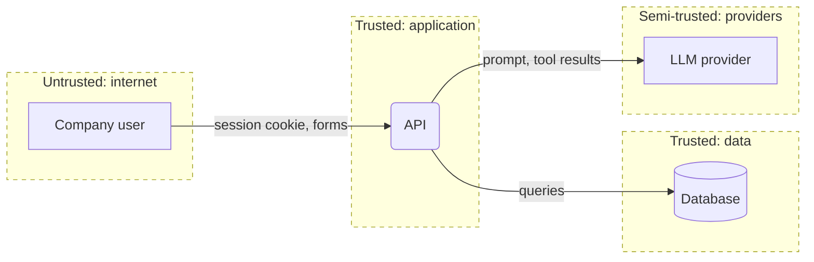

# Threat model: [System or feature name]

**Scope:** [whole system / application X / feature Y]
**Last updated:** [YYYY-MM-DD]
**Owner:** [name or team]

One paragraph: what this system does, who uses it, and the one or two threats that matter most.

## 1. What are we working on?

### System profile

| Application | Type | Stack | Deployed as | Auth | Tenancy | AI |
| --- | --- | --- | --- | --- | --- | --- |
| [portal] | [browser web app + API] | [Next.js 15, Prisma, Postgres] | [Vercel] | [session cookie via Auth.js] | [organizationId on every table] | [support chatbot, OpenAI, 2 tools] |
| [worker] | [queue consumer] | [Node, BullMQ] | [container] | [none: trusts queue] | [tenantId in job payload] | [none] |

Architecture: [monolith / frontend + API / services; one sentence]
Data stores: [Postgres (requests, users, documents metadata), object storage (uploads), Redis (sessions, queue)]
External systems: [email provider, LLM provider, mocked ERP]
Multi-tenancy: [how the tenant is resolved and where it is enforced]

### Assets (what we protect)

- [e.g. customer requests and documents, user accounts and sessions, admin permissions, LLM API key and budget, integration secrets]

### Actors

| Actor | Access | Motivation |
| --- | --- | --- |
| Anonymous internet user | Public endpoints | [ ] |
| Logged-in user of tenant A | Own tenant's data | Read or change tenant B's data |
| Logged-in user without admin role | Standard features | Reach admin actions |
| Untrusted content the system reads | Uploaded files, emails, web pages, queue messages, tool output | Indirect prompt injection, parser abuse |
| Compromised dependency or integration | Build or runtime | [ ] |

### Entry points

| Application | Entry point | Auth required | Notes |
| --- | --- | --- | --- |
| [portal] | [GET /api/requests/{id}] | [yes: any logged-in user] | [loads by id only] |

### Data flow and trust boundaries

Boundaries: [browser ↔ application; application ↔ data; application ↔ providers; user content ↔ model context; model output ↔ tools]
Diagram source: `docs/security/threat-model.mmd` [rendered: `threat-model.svg` if available]

### AI components

| Component | Untrusted input | Sensitive data / systems | Changes state or sends externally | Rule of Two verdict |
| --- | --- | --- | --- | --- |
| [Chatbot] | [yes: reads request text] | [yes: reads requests] | [yes: creates requests] | [3 of 3: needs human approval or remove one property] |

### Assumptions and open questions

- [ ] [e.g. sessions are issued by X; not verified in code]

## 2. What can go wrong?

| ID | Threat | STRIDE | Where | L | I | Response | Control today | How we verify | OWASP / CWE |
| --- | --- | --- | --- | --- | --- | --- | --- | --- | --- |
| T-01 | [specific threat against a specific element] | [S/T/R/I/D/E] | [application: file or endpoint] | [H/M/L] | [H/M/L] | [Mitigate / Eliminate / Transfer / Accept: how] | [existing control or "none"] | [test, scan, or manual check] | [A0x:2025, API x:2023, LLM0x:2026, ASI0x, CWE-nnn] |

## 3. Test scope

Copied from "How we verify", grouped by method, so a tester or pentest agent can start here.

| Method | What to try | Threats |
| --- | --- | --- |
| Integration tests | [ ] | [T-01] |
| SAST | [ ] | [ ] |
| DAST (no session, then user A's session) | [ ] | [ ] |
| Manual, two accounts | [ ] | [ ] |
| Prompt injection | [ ] | [ ] |

**Out of scope:** [provider infrastructure, volumetric DoS, social engineering, production, shared QA and DEV environments]

**Rules of engagement:** [isolated environment only; synthetic data only, seeded for at least two tenants and two roles; nothing is tested against real customer data]

## 4. Did we do a good job?

- [ ] Every application in scope has a row in the System profile
- [ ] Every entry point and every boundary crossing on the diagram was walked through all six STRIDE letters
- [ ] Every AI component has a Rule of Two verdict
- [ ] Every High threat has a mitigation and a verification
- [ ] Cross-tenant and cross-role threats are present (or explicitly not applicable)
- [ ] Threat IDs are annotated on the diagram's flows
- [ ] Assumptions are marked, not presented as facts
- [ ] The document contains no attack instructions, payloads or exploit code
- [ ] Out of scope and rules of engagement are written down

## Changelog

- [YYYY-MM-DD] Initial model
