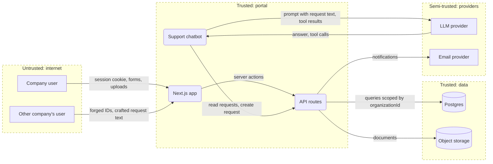

# Data flow diagram conventions

The diagram is the artifact reviewers look at first. It must show, at a glance, where
data enters, where it is stored, where it leaves, and which flows cross a trust
boundary. Mermaid is the format because it lives in the repository as text, diffs in
pull requests, and renders in GitHub, GitLab and most editors without tooling.

## Shapes

| DFD element | Mermaid | Example |
| --- | --- | --- |
| External entity (person or system outside our control) | rectangle `[ ]` | `User[Company user]`, `LLM[LLM provider]` |
| Process (code we run) | rounded `( )` | `API(Portal API)` |
| Data store | cylinder `[( )]` | `DB[(Postgres)]`, `Files[(Object storage)]` |
| Data flow | labelled arrow | `User -->|credentials, requests| Web` |
| Trust boundary | subgraph with a dashed style | see below |

Label every flow with what it carries (data, not protocol). "HTTPS" says nothing;
"session cookie, request form" says what an attacker on that edge could read or forge.

## Trust boundaries

A trust boundary is a line where the level of trust changes: browser to server,
server to database, our code to a third-party API, user content to a model's context,
model output to a tool that changes state. Put each side in its own subgraph and
style the subgraphs dashed so they read as boundaries, not as components.



Name boundaries by trust level, not by technology ("Untrusted: internet", not
"Cloudflare"), so the reader knows which way the arrows get more dangerous.

## Annotating threats

Once the threat table exists, add the threat IDs to the flows they sit on, so the
picture and the table cross-reference:

```
Attacker -->|"forged IDs (T-03), crafted request text (T-07)"| Web
Bot -->|"read requests, create request (T-07, T-08)"| API
```

Quote the label when it contains parentheses or commas. A flow with no threat ID after
step 3 is either genuinely safe or was not walked through STRIDE; check which.

## Size and levels

- One diagram for a system up to roughly 15 nodes. Beyond that, draw a context
  diagram (applications and external systems only, no internals) and one diagram per
  application in scope.
- Leave out components that neither touch sensitive data nor cross a boundary
  (a static asset CDN, a logging sidecar) unless a threat lives there.
- For a feature-level model, draw only the slice the feature touches and reference the
  system diagram for the rest.

## Files

- Inline the diagram in `docs/security/threat-model.md` under "Data flow and trust
  boundaries".
- Save the same source to `docs/security/threat-model.mmd` for separate rendering.
- Rendering, when a tool is already present: `mmdc -i docs/security/threat-model.mmd
  -o docs/security/threat-model.svg`, or `npx @mermaid-js/mermaid-cli` with the same
  arguments. If neither is available, say how to render it instead of installing a
  headless browser into the user's project.
